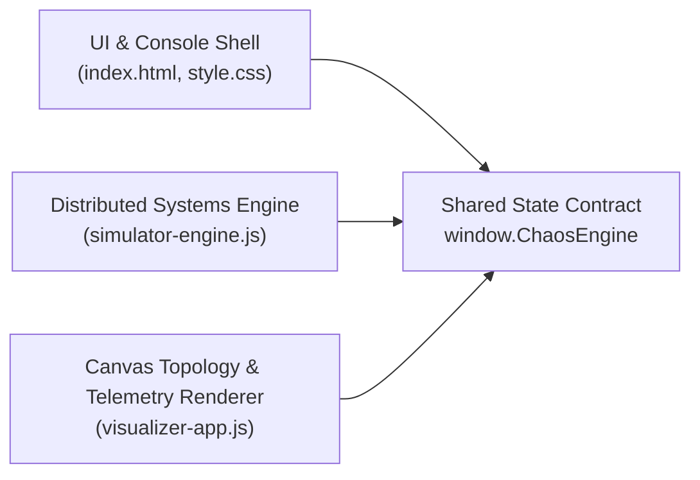

# ⚡ AetherChaos — Cloud Architecture & Chaos Engineering Sandbox

**AetherChaos** is a zero-dependency, interactive **Cloud Architecture & Chaos Engineering Sandbox** designed for visualizing distributed systems resilience, non-linear queueing congestion, upstream backpressure cascades, **Horizontal Pod Autoscaling (HPA)**, and **Circuit Breaker** fault isolation.

Built as an engineering experiment using **Google Antigravity** and **Gemini 4 Argon** via contract-first, parallel multi-agent decomposition.

---

## 🏗️ Architecture & Multi-Agent Decomposition

Instead of single-prompt sequential generation, the codebase is structured around a strict shared state contract (`window.ChaosEngine`) and split into three isolated modules built in parallel:



| File | Responsibility |
| :--- | :--- |
| **`index.html` & `style.css`** | SRE Mission Control console layout, Golden Signals KPI ribbon, Chaos Injection Deck, Node Inspector drawer, and strict Content Security Policy (`default-src 'self'`). |
| **`simulator-engine.js`** | Core distributed systems simulation engine (`window.ChaosEngine`): forward traffic routing, non-linear queueing congestion curves, reverse-topological backpressure propagation, HPA scaling state machine, and Circuit Breaker logic. |
| **`visualizer-app.js`** | High-DPI HTML5 Canvas renderer for the directed acyclic graph (DAG), cubic Bézier conduits, animated telemetry packets, rolling 60-second Golden Signals sparklines, and safe DOM controller. |
| **`test/contract.test.js`** | Automated cross-agent contract & physics test suite (`node:test`) verifying DOM bindings, shared state aliases (`state.kpis` / `state.globalMetrics`), non-null event timestamps (`time` / `timeStr`), HPA scaling, and cascading failure recovery. |

---

## 🌐 Included Cloud Topologies

1. **`genai_rag` — Gemini 4 Argon RAG & Vertex Pipeline**
   - `Cloud Armor Edge LB` → `Apigee API Gateway` & `IAM & Token Guard` → `RAG Query Orchestrator` → `Vertex AI Gemini 4 Argon`, `AlloyDB Vector Search`, `Memorystore Semantic Cache` → `BigQuery Telemetry Sink`
2. **`ecommerce` — GCP E-Commerce Cloud Native**
   - `Cloud CDN & Global LB` → `Apigee API Gateway` & `Identity Platform Auth` → `Catalog GKE Service` & `Checkout GKE Service` → `Memorystore Redis Cache`, `Cloud Spanner Primary`, `Pub/Sub Order Events`
3. **`payments` — Global FinTech Payment Mesh**
   - `Global Front Door LB` → `Vertex Fraud Detection AI` & `Cloud HSM Crypto Vault` → `Payment Router Mesh` → `Ledger Core Service` → `Cloud Spanner Multi-Region`, `Pub/Sub Audit Log`, `Settlement Worker Pool`

---

## ⚙️ What the Simulation Models (and What It Simplifies)

### Modeled Behaviors
- **Forward Request Routing**: Propagates ingress traffic (`req/s`) across weighted directed edges, accounting for upstream error shedding and downstream circuit breaker throttling.
- **Non-Linear Queueing Congestion**: Models utilization-driven latency growth ($\rho = \text{RPS} / (\text{pods} \times \text{capacityPerPod})$). Below 70% utilization, latency scales gently; above 70–85%, queueing delay climbs steeply along a non-linear congestion curve.
- **Upstream Backpressure Cascade (Reverse DAG Pass)**: When a downstream dependency (e.g., `AlloyDB Vector Search` or `Cloud Spanner`) saturates or goes offline, upstream callers accumulate blocked worker threads, increasing both caller latency and CPU pressure.
- **Circuit Breakers (`CB OPEN`)**: When autonomous self-healing is enabled and a downstream node fails or exceeds a 65% error rate, the circuit breaker trips—replacing cascading timeout penalties with a fast-fail fallback and a 12% canary probe trickle.
- **Horizontal Pod Autoscaler (HPA)**: Automatically scales active GKE pod replicas up to `maxPods` when node CPU utilization exceeds 78%.

### Engineering Boundaries & Intentional Simplifications
This project is a **first-order architectural sandbox** for design reviews, what-if exploration, and SRE training—not a replacement for production load testing (`k6`, `Locust`) or live observability:
- **Heuristic Tail Latency**: Uses deterministic congestion curves rather than heavy-tailed token-length distributions ($M/G/c$) typical of variable-length LLM inference.
- **Accelerated HPA Readiness**: Applies HPA pod scale-ups instantly with a `1.6s` cooldown between steps so autoscaling feedback is immediately visible during interactive demos (whereas real GKE node provisioning and container/model cold starts take tens of seconds).
- **Static Baseline Capacities**: Per-pod capacities (`capacityPerPod`) and base latencies are synthetic presets rather than calibrated against live cluster telemetry.

---

## 🚀 Quick Start & Contract Tests

No external npm dependencies are required.

```bash
# Clone the repository
git clone https://github.com/mrango/aetherchaos.git
cd aetherchaos

# Run the automated cross-agent contract & physics test suite (Node >= 18)
npm test

# Start the local HTTP server bound to localhost
npm start
# (or: python3 -m http.server 8765 --bind 127.0.0.1)
```

Then open **`http://127.0.0.1:8765`** in your browser.

### Interactive Controls
- **Click any node** on the canvas to inspect its live CPU load, P99 latency, throughput, error rate, and active pod count.
- **Double-click any node** to immediately terminate (`SIGKILL`) or restore that service.
- **Drag any node** to reposition the topology layout in real time.
- Use the **Chaos Injection Deck** buttons (`💥 Kill Random Service`, `🌊 Flash Traffic Surge (3x)`, `⚡ Region Latency Storm`, `🔥 Saturate Primary DB`, `🛡️ Auto-Heal & Reset Breakers`) to test resilience under fault conditions.

---

## 🔒 Security Posture

- **Strict Content Security Policy (CSP)**: Enforces `default-src 'self'; script-src 'self'; style-src 'self'` with zero inline scripts or inline styles.
- **Safe DOM Manipulation**: Uses `document.createElement()`, `textContent`, and `replaceChildren()` exclusively—zero `innerHTML` or dynamic code execution sinks.
- **Input Validation**: All user-controlled parameters (topology keys, traffic slider values, node IDs, pod counts) are validated against strict allow-lists and clamped numeric bounds.

---

## 📄 License

This project is licensed under the **MIT License** — see the [LICENSE](LICENSE) file for details.

